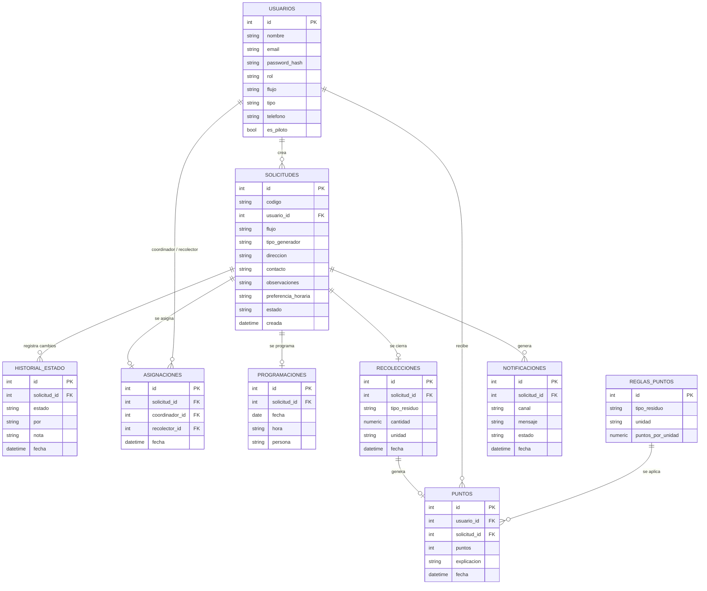

# Modelo de datos · EcoConecta Villas de San Pablo

Base de datos: **PostgreSQL**, acceso con SQLAlchemy y Psycopg.

## Diagrama de relaciones

## Tablas principales

| Tabla | Para qué sirve |
|---|---|
| `usuarios` | Todas las personas, con su rol: solicitante, coordinador de huerteros, coordinador de recicladores, recolector o administrador. `es_piloto` habilita a quien puede solicitar (RN-08). |
| `solicitudes` | Cada solicitud con su código, flujo (orgánico o reciclable) y estado actual. |
| `historial_estado` | Una fila por cada cambio de estado, para la trazabilidad (RN-04). |
| `asignaciones` | Asocia la solicitud con su coordinador y su recolector (RN-03). |
| `programaciones` | Día, hora y persona encargada (RN-02). |
| `recolecciones` | Cierre de la solicitud con el tipo y la cantidad entregada. |
| `reglas_puntos` | Puntos por unidad según el material; la edita el administrador (RN-06). |
| `puntos` | Movimientos de puntos del usuario, con la explicación del cálculo. |
| `notificaciones` | Mensajes enviados o simulados por WhatsApp. |

## Valores permitidos

- **Roles:** `solicitante`, `coord_huerteros`, `coord_recicladores`, `recolector`, `admin`
- **Flujos:** `organico`, `reciclable`
- **Estados:** `recibida`, `en_revision`, `asignada`, `programada`, `recolectada`, `cancelada`
- **Tipos de residuo:** `organico`, `plastico`, `carton_papel`, `vidrio`, `metal`

## Privacidad (RN-07)

El contacto y la dirección solo se entregan por la API a quien necesita atender la solicitud (coordinador del flujo y recolector asignado). Al modelo de IA no se envían datos personales.